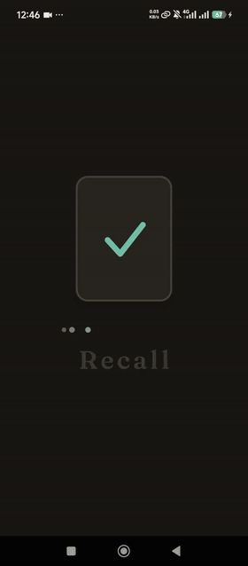
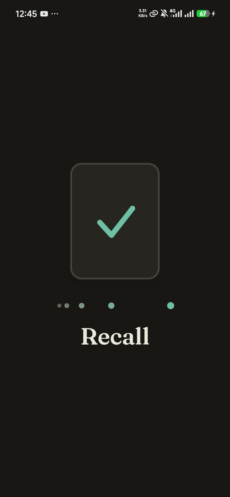
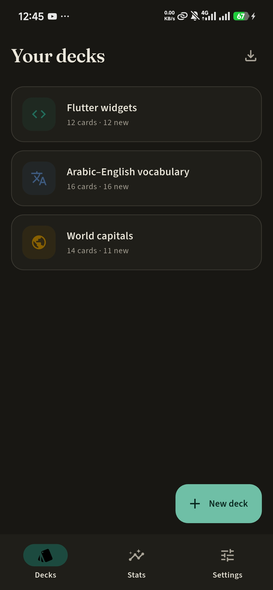
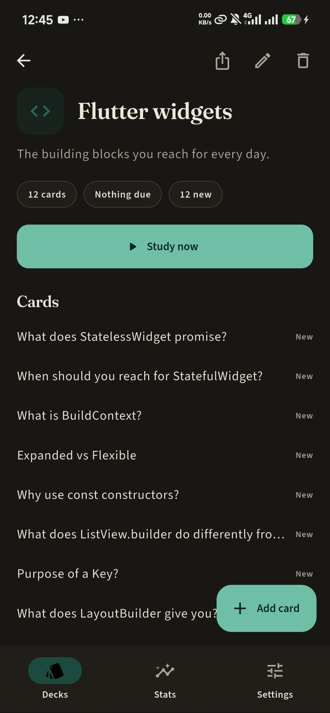
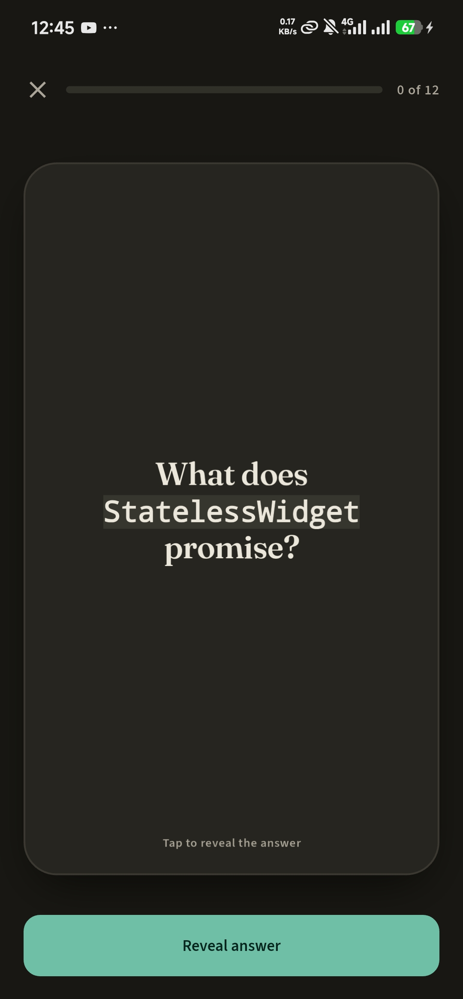
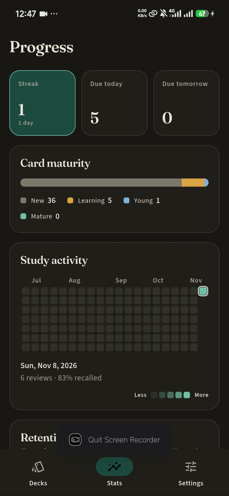
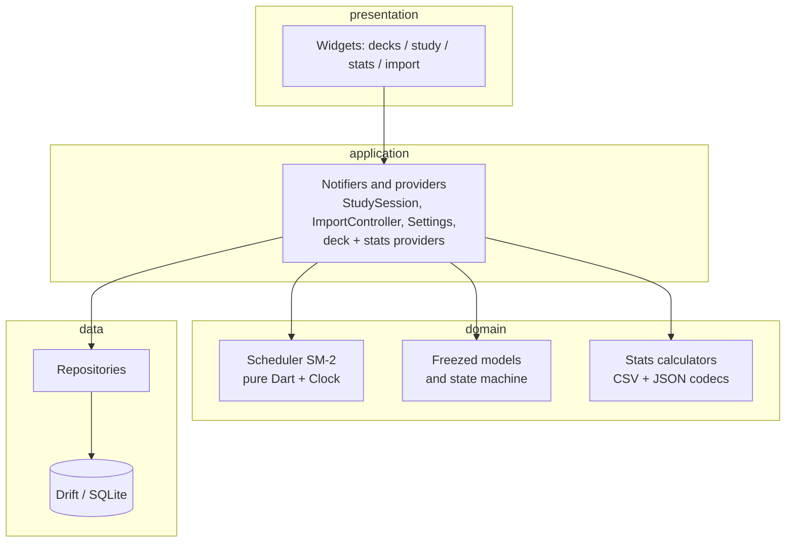
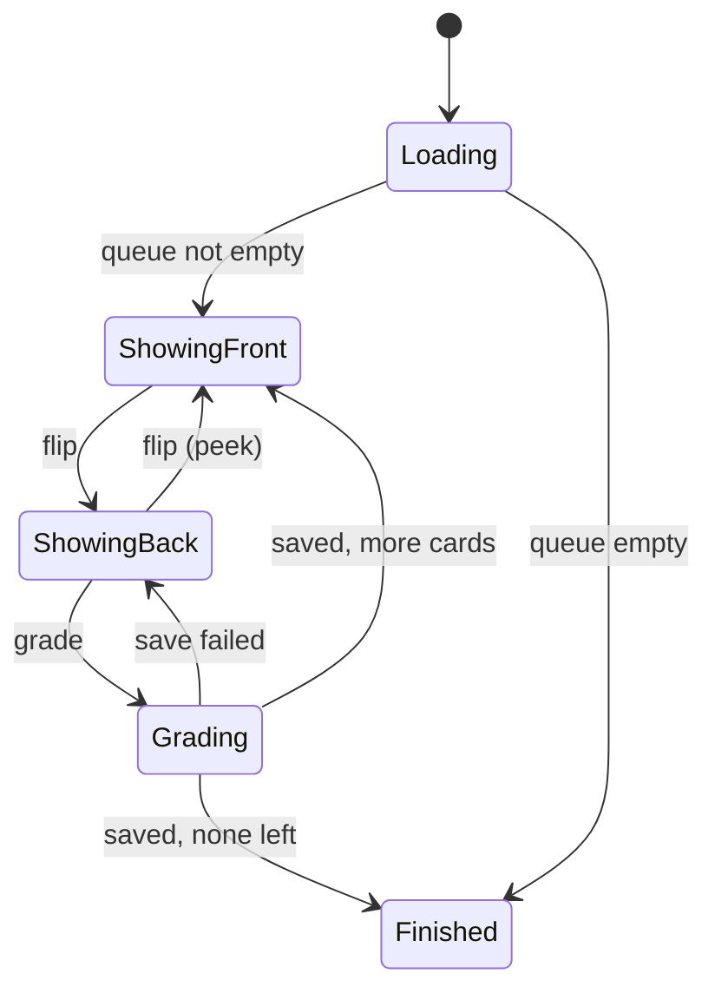

<div align="center">

# Recall

**A spaced-repetition flashcard app with physics-based swipe grading, hand-painted stats and full Arabic support.**

[](https://github.com/Mohamed-Almotasim/recall/actions/workflows/ci.yml)


-444)



[Watch the full demo video](assets/images/recall-video.mp4) · [How SM-2 works here](#how-sm-2-works-here) · [Architecture](#architecture) · [Run it](#run)

</div>

A portfolio piece built in Flutter. The scope is small on purpose and the parts that matter are done properly: a tested scheduling algorithm, physics-based gestures, hand-painted charts, and a full Arabic (RTL) experience.

## Showcase

<table>
  <tr>
    <td align="center" width="33%"><br><sub><b>Splash</b>: one <code>CustomPainter</code>, no packages</sub></td>
    <td align="center" width="33%"><br><sub><b>Decks</b>: seeded demo decks</sub></td>
    <td align="center" width="33%"><br><sub><b>Deck detail</b>: cards and what's due</sub></td>
  </tr>
  <tr>
    <td align="center"><br><sub><b>Study</b>: tap to flip, swipe to grade</sub></td>
    <td align="center"><br><sub><b>Progress</b>: streak, maturity, heatmap</sub></td>
    <td align="center" valign="middle"><sub>The <a href="assets/images/recall-video.mp4">demo video</a> covers decks, stats, switching theme and language to Arabic (RTL), then a study session with the 3D flip and swipe grading.<br><br>Generated screenshots in both languages and themes are in <a href="docs/screenshots"><code>docs/screenshots</code></a>.</sub></td>
  </tr>
</table>

## Features

- **Decks and cards.** Create, edit, delete. Name, description, icon and colour per deck. Cards support `**bold**`, `*italic*` and `` `code` ``, plus an optional image.
- **Study sessions.** Cards come due on a schedule. Tap to flip (3D, spring-driven). Grade by swiping: left = Again, up = Hard, right = Good, down = Easy. The card follows your finger, tilts, tints its edge with the grade colour, springs back if you let go early and flies off with your release velocity otherwise. Four grade buttons are the accessible alternative and each shows the next interval ("Good · 4d"). Keyboard: Space flips, 1–4 grade.
- **SM-2 scheduler** with learning steps, lapses and relearning, as a pure Dart module with table-driven tests.
- **Stats from history.** Every answer is logged; everything on the stats page is computed from those logs. GitHub-style yearly heatmap (tap a day), retention curve, streak, due today/tomorrow, new/learning/young/mature breakdown. All drawn with `CustomPainter`, no chart package.
- **Import / export.** Paste or pick CSV/TSV, preview, map columns, import. Export a deck to JSON, import it back.
- **Arabic + English**, full RTL. Direction is detected per card side, so an English card in the Arabic UI (and the reverse) reads correctly.
- **Animated splash** built from one `CustomPainter`, with zero app dependencies (`lib/splash/recall_splash.dart`, copy it anywhere).
- **Adaptive.** Phone first. From 840dp wide the deck list and the selected deck sit side by side. The study card stays centred on large screens.
- **Reduced motion.** Honours the OS setting plus an in-app switch: flips become cross-fades, swipes become fades, the splash and summary skip to their final state.

## How SM-2 works here

Cards move through four phases: **new → learning → review**, with **relearning** after a lapse.

*Learning / relearning* use fixed steps (default 1 min, 10 min; relearning 10 min):

| Grade | Effect |
|-------|--------|
| Again | back to the first step |
| Hard | repeat the current step (avg of the first two on step 0) |
| Good | next step; after the last step the card **graduates** to a 1 day interval (4 days on Easy) |
| Easy | graduate immediately |

*Review* cards have an interval `I` (days) and an ease `E` (start 2.5, floor 1.3). With `late` = whole days past due:

| Grade | New interval | Ease |
|-------|--------------|------|
| Again | lapse: relearning, interval `max(1, I × 0)` | −0.20 |
| Hard | `max(I+1, round(I × 1.2))` | −0.15 |
| Good | `max(I+1, round((I + late/2) × E))` | unchanged |
| Easy | `max(I+1, round((I + late) × E × 1.3))` | +0.15 |

Why SM-2 and not FSRS-lite: every output is a closed-form number, so the tests can assert exact values. The code is in `lib/features/study/domain/scheduler/`. It imports nothing but a `Clock` interface, and `preview()` runs the same `review()` for each grade, so the hints on the buttons cannot disagree with what happens.

## Architecture



Rules: presentation → application → domain ← data. Widgets hold no logic: they render state and send events (`flip`, `grade`). The domain does not import Flutter or drift.

### Study session state machine



States are a sealed freezed union (`StudyLoading`, `ShowingFront`, `ShowingBack`, `Grading`, `StudyFinished`). Cards answered Again/Hard (or still in learning steps) re-enter the queue a few cards later in the same session.

## Folder structure

```
lib/
  main.dart
  app/            app.dart, router.dart (typed go_router), settings, providers, theme
  core/           clock, markdown-lite, text direction, shared widgets
  data/database/  drift tables, AppDatabase, migrations
  splash/         recall_splash.dart (standalone)
  l10n/           app_en.arb, app_ar.arb (+ generated)
  features/
    decks/        presentation / application / domain / data
    study/        presentation / application / domain (scheduler, state) / data
    stats/        presentation (painters) / application / domain (calculators) / data
    import_export/presentation / application / domain (csv, json)
    settings/
test/             scheduler, repositories, session state machine, swipe widget tests, csv, stats
integration_test/ import -> study -> grade -> stats
tool/             screenshot and splash-frame generators
docs/             PLAN.md, screenshots/
```

## Key decisions

- **Stats come from `ReviewLogs`, not from card state.** Card state is a cache for scheduling; history is the source of truth, so heatmap, streak and retention can be recomputed at any time.
- **Swipe uses `SpringSimulation`, not tweens.** Release velocity feeds straight into the simulation, so a flick feels like a flick. Grade is chosen from the position projected 120 ms ahead, so fast short flicks count.
- **Heatmap `shouldRepaint` compares data**, not identity; the card is wrapped in a `RepaintBoundary`.
- **Settings live in a drift key/value table** rather than adding `shared_preferences`.
- **Fonts are bundled** (Fraunces, Source Sans 3, IBM Plex Sans Arabic; all OFL) so the app and the splash work offline and render the same everywhere.
- **No `riverpod_lint`/`custom_lint`**: they do not resolve against the analyzer version the generators need. `very_good_analysis` runs at zero issues.
- **Dates use Western digits in Arabic** to match the numbers elsewhere in the UI.

## Run

```bash
flutter pub get
dart run build_runner build      # freezed, riverpod, drift, go_router
flutter run                      # pass --dart-define=DEMO_HISTORY=true on a fresh install for a year of fake history
```

Windows desktop builds need Developer Mode on (plugin symlinks).

Deep links: `recall://open/decks/<id>` and `recall://open/decks/<id>/study` (Android and iOS are configured; on web the same paths work as URLs).

**Web:** drift needs `sqlite3.wasm` and `drift_worker.js` in `web/`. Download the versions matching `pubspec.lock` from the [sqlite3.dart](https://github.com/simolus3/sqlite3.dart/releases) and [drift](https://github.com/simolus3/drift/releases) releases. They are not committed.

## Test

```bash
flutter analyze
flutter test                                  # unit, repository, session, widget tests
flutter test integration_test -d <device>     # end-to-end flow
flutter test tool/screenshots_test.dart       # regenerate docs/screenshots (en/ar x light/dark, 390x844)
```

| Suite | What it covers |
|-------|----------------|
| `scheduler_test` | grades × phases × lapses table, late bonus, clamps, preview ≡ review, 1000-seed invariants |
| `repository_test` | in-memory drift: CRUD, cascade, queue order, atomic review save, seed, settings |
| `study_session_test` | state machine through `ProviderContainer`, including save failure |
| `study_swipe_test` | drag gestures in four directions, spring-back, buttons, keyboard |
| `csv_import_test`, `deck_json_test` | delimiter sniffing, quotes/BOM/CRLF, column mapping, JSON round trip |
| `stats_calculator_test` | heatmap, streak, retention buckets, maturity, due forecast |

### Performance

The heatmap repaints only when its data or selection changes, and the study card sits in a `RepaintBoundary` so the drag repaints only that layer. Profile-mode frame timing was **not** measured (it needs a physical device): run `flutter run --profile` and watch the Performance overlay while swiping at 60/120 Hz.
