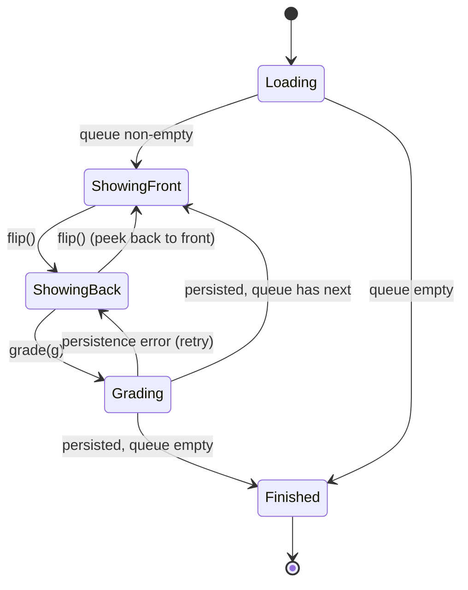
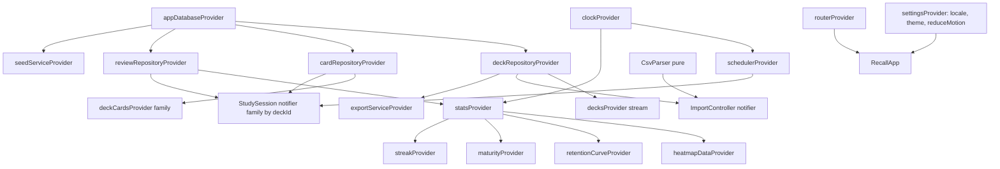

# Recall — Implementation Plan

Spaced-repetition flashcards. Portfolio scope: motion, custom painting, real scheduling logic.
Toolchain verified locally: Flutter 3.47.7 / Dart 3.13.5. Package versions below were resolved with `flutter pub add --dry-run` on 2026-11-08.

## 1. Screens

| # | Screen | Route | Notes |
|---|--------|-------|-------|
| 0 | Splash | (pre-router) | Self-contained `RecallSplash` widget, zero app imports |
| 1 | Deck list (home) | `/` | Staggered entrance; due-count per deck; FAB "New deck". Wide layout: master pane |
| 2 | Deck detail | `/decks/:deckId` | Header, due/new/learning counts, card list, Study button, export, edit, delete. Wide layout: detail pane |
| 3 | Deck editor | `/decks/new`, `/decks/:deckId/edit` | Name, description, icon (vector icon set, no emoji), accent swatch |
| 4 | Card editor | `/decks/:deckId/cards/new`, `.../cards/:cardId` | Front/back with markdown toolbar (bold, italic, code), live preview, optional image (file picker) |
| 5 | Study | `/decks/:deckId/study` | Hero card, flip, swipe/buttons, progress bar, summary at end |
| 6 | Stats | `/stats` | Streak, due today/tomorrow, maturity bar, heatmap, retention curve |
| 7 | Import | `/decks/import` | Paste/file → delimiter detect → preview → column mapping → create |
| 8 | Settings | `/settings` | Language (system/en/ar), theme (system/light/dark), reduced-motion override |

Bottom nav (phone) / nav rail (wide): Decks, Stats, Settings.
Deep links: `recall://decks/:id` and `recall://decks/:id/study` (plus the same paths on web).

## 2. Data model

### Drift tables (schema v1)

```
Decks        id PK autoinc | name | description | colorValue int | iconKey text | createdAt | updatedAt
Cards        id PK autoinc | deckId FK→Decks (cascade) | front | back | imagePath? | createdAt
CardStates   cardId PK FK→Cards (cascade) | phase (0 new,1 learning,2 review,3 relearning)
             | stepIndex | ease real | intervalDays int | reps int | lapses int | due datetime (UTC)
             | lastReviewedAt?                                  -- denormalised scheduling state
ReviewLogs   id PK | cardId FK | deckId FK | reviewedAt | grade (0..3) | phaseBefore
             | intervalBefore | intervalAfter | easeAfter | elapsedDays | durationMs
             idx(reviewedAt), idx(cardId)
```

`CardStates` is a cache of the latest scheduling result; **all stats are computed from `ReviewLogs`**.
Migrations: `schemaVersion = 1`, `MigrationStrategy` with `onCreate` + `onUpgrade` stub using `stepByStep` and drift's schema-verification test (`drift_dev schema dump/steps`).

### Domain models (freezed)

`Deck`, `Card`, `CardState`, `ReviewLog`, `Grade` (enum: again, hard, good, easy), `Phase` (enum), `SchedulerConfig`, `DeckStats`, `DayActivity`, `RetentionPoint`, `MaturityBreakdown`, `CsvPreview`, `ColumnMapping`.
Maturity: new = phase new; learning = learning/relearning; young = review & interval < 21d; mature = interval ≥ 21d.

## 3. Scheduler spec (SM-2 with Anki-style learning steps)

**Choice: SM-2, not FSRS-lite.** SM-2 is fully specified by closed-form formulas, so the table-driven tests can assert exact numbers; FSRS needs fitted weights and a memory model whose "correct" outputs can't be verified independently. The retention curve in Stats gives the empirical view that FSRS would otherwise provide.

Pure Dart in `domain/scheduler/`, depends on nothing (no Flutter, no drift). `Clock` is an interface injected into the scheduler; tests use `FixedClock`.

### Config (defaults)
```
learningSteps   = [1 min, 10 min]
relearningSteps = [10 min]
graduatingInterval = 1 day, easyInterval = 4 days
startingEase = 2.5, minEase = 1.3
easyBonus = 1.3, hardMultiplier = 1.2, intervalModifier = 1.0
lapseNewIntervalFactor = 0.0 (→ min 1 day), maxInterval = 36500 days
fuzz = off by default (injectable for tests)
```

### Phases

**New / Learning / Relearning** (step list `S`, index `i`):
- Again → `i = 0`, due = now + S[0]
- Hard → stay at `i`, due = now + (i == 0 && |S|>1 ? avg(S[0],S[1]) : S[i]); if |S|==1, S[0]×1.5
- Good → `i+1`; if `i+1 < |S|` due = now + S[i+1]; else **graduate**: interval = graduatingInterval (relearning: the interval kept after the lapse), phase = review
- Easy → graduate immediately with `easyInterval` (relearning: kept interval + 1 day)

**Review** (interval `I`, ease `E`, elapsed days `d` since due, `late = max(0, d)`):
```
Again: lapses += 1
       E' = max(minEase, E − 0.20)
       I' = max(1, round(I × lapseNewIntervalFactor))
       phase = relearning, i = 0, due = now + relearningSteps[0]
Hard:  E' = max(minEase, E − 0.15)
       I' = max(I + 1, round(I × hardMultiplier × intervalModifier))
Good:  E' = E
       I' = max(I + 1, round((I + late/2) × E × intervalModifier))
Easy:  E' = E + 0.15
       I' = max(I + 1, round((I + late) × E × easyBonus × intervalModifier))
```
All `I'` clamped to `maxInterval`. Review due date = start-of-next-day-aligned `now + I'` days (day boundary is local midnight, passed in via Clock).

### API
```dart
sealed class / record: ({CardState next, ReviewOutcome ...})
class Scheduler { Scheduler(Clock, SchedulerConfig);
  CardState review(CardState s, Grade g);
  Map<Grade, Duration> preview(CardState s);   // powers "Good · 4d" labels
}
String formatInterval(Duration)  // "10m", "4d", "2.3mo", "1.1y" (l10n via formatter callback)
```
Preview is `review` run for each grade, so the hint can never disagree with the real result.

### Tests (table-driven, FixedClock)
grades × phases {new, learning step 0/1, review, relearning} × lapses {0, 1, many}; ease floor and ceiling; late-review bonus; maxInterval clamp; monotonic interval (`I' ≥ I+1` for Hard/Good/Easy); preview ≡ review; day-boundary due dates; invariants via a randomised property loop (1000 seeds): ease ≥ 1.3, due > now.

## 4. Study session state machine



```dart
@freezed
sealed class StudyState {
  const factory StudyState.loading() = Loading;
  const factory StudyState.showingFront({required SessionData data}) = ShowingFront;
  const factory StudyState.showingBack({required SessionData data}) = ShowingBack;
  const factory StudyState.grading({required SessionData data, required Grade grade}) = Grading;
  const factory StudyState.finished({required SessionSummary summary}) = Finished;
}
```
`SessionData` = current card, remaining queue, counts, intervals preview (`Map<Grade, Duration>`), per-card start time. Again/Hard cards that land in learning re-enter the queue (sorted by due) within the session. Queue order: due learning, due review, new (daily new-card cap 20, review cap 200). Invalid transitions (e.g. `grade` while `showingFront`) are no-ops, asserted in tests.

Widgets only call `flip()`/`grade()` and render state; swipe physics (drag offset, SpringSimulation, fly-off velocity) live in a presentation-level animation controller, which reports the final `Grade` to the notifier.

## 5. Provider graph (Riverpod 3 + `@riverpod`)



## 6. Folder tree

```
lib/
  main.dart                       app/ bootstrap, ProviderScope, seed on first run
  app/
    app.dart  router.dart  router.g.dart
    theme/  (colors, typography, theme)  l10n/ (app_en.arb, app_ar.arb)
  core/
    clock.dart  text_direction.dart  markdown_lite.dart  motion.dart (reduced-motion helper)
    widgets/ (adaptive scaffold, section header)
  splash/
    recall_splash.dart            standalone, only imports flutter/*
  features/
    decks/        presentation/ application/ domain/ data/
    study/        presentation/ (study_page, flip_card, swipe_card, grade_bar) application/ domain/scheduler/ data/
    stats/        presentation/ (heatmap_painter, retention_painter, maturity_bar) application/ domain/ data/
    import_export/ presentation/ application/ domain/ (csv_parser, column_mapping, deck_json) data/
  data/ (shared)  database/ (tables, app_database, migrations, seed/)
assets/fonts/  assets/seed/ (decks as JSON)
test/ (unit, repository, session, widget)  integration_test/app_flow_test.dart
docs/ PLAN.md  screenshots/
.github/workflows/ci.yml
```
Dependency rule: presentation → application → domain ← data. `domain/` imports nothing outside Dart core + freezed annotations (scheduler imports nothing at all).

## 7. Packages

Runtime
| Package | Version | Why |
|---|---|---|
| flutter_riverpod | ^3.5.0 | state |
| riverpod_annotation | ^4.0.8 | `@riverpod` |
| freezed_annotation | ^3.1.0 | models/states |
| drift | ^2.35.3 | SQLite |
| drift_flutter | ^0.3.1 | cross-platform connection (incl. web wasm) |
| go_router | ^18.1.3 | routing, deep links |
| intl | ^0.20.3 | l10n formatting |
| flutter_localizations | sdk | l10n |
| path_provider | ^2.1.6 | image storage dir |
| csv | ^8.0.0 | CSV/TSV parsing (quote/escape edge cases are not worth hand-rolling) |
| file_picker | ^13.3.2 | CSV import, card image |

Dev
| Package | Version |
|---|---|
| build_runner | ^2.17.1 |
| riverpod_generator | ^4.0.10 |
| freezed | ^4.0.3 |
| drift_dev | ^2.35.2 |
| go_router_builder | ^4.5.3 |
| very_good_analysis | ^11.0.0 |
| flutter_test, integration_test | sdk |

**Not included (needs your OK if you want them):**
- `riverpod_lint` / `custom_lint`: do not resolve against the current analyzer (14.x) alongside the generators. Skipping; very_good_analysis covers lints.
- `google_fonts`: avoided on purpose. Fonts are **bundled** as assets (offline, and the splash/portfolio reuse stays clean).
- `shared_preferences`: settings (locale/theme/motion) would be stored in a drift `Settings` key-value table instead, so no extra package.
- `mocktail`: not needed; in-memory drift and fake Clock cover the tests.
- Markdown: a ~60-line `markdown_lite` parser (bold/italic/code → `TextSpan`s) instead of a markdown package.

## 8. Design direction

- **Type:** Fraunces (headings, characterful serif), Source Sans 3 (body), IBM Plex Sans Arabic (Arabic UI and cards). Bundled from OFL sources into `assets/fonts/`.
- **Palette:** warm paper off-white / deep ink dark; one accent (deep teal-green `#1F6F5C`, dark-mode lift `#5FB59C`). Grade colors are muted, desaturated: Again brick, Hard amber, Good accent-green, Easy blue-slate. No purple gradients, glass, or emoji.
- **Card:** layered soft shadow, 3D flip (`Matrix4` perspective, rotateY, content swapped at 90°), swipe edge tint proportional to drag distance along the dominant axis.
- **Swipe physics:** pan updates offset + rotation (`dx/width * 0.15 rad`); release below distance/velocity threshold → `SpringSimulation` back; above → fling with release velocity, card exits the viewport, then notifier `grade()`. `RepaintBoundary` around the card.
- **Reduced motion:** `MediaQuery.disableAnimations` or settings override → flip becomes a cross-fade, no stagger, fling replaced by quick fade.
- **Splash:** `RecallSplash({onFinished})`, pure `CustomPainter` + `AnimationController`: a card outline draws on, flips, and a spaced-interval dot sequence settles into the wordmark.
- **Heatmap:** 53×7 grid, 5 intensity steps from the accent, `shouldRepaint` compares an immutable data object; tap → hit-test cell → bottom sheet with day details. Retention curve: % correct (Good/Easy of review-phase logs) by interval bucket, smooth path with area fill.
- **Adaptive:** `LayoutBuilder` breakpoint at 840 dp → two-pane (deck list + detail); study card capped at 560 dp and centered; `Shortcuts/Actions` for Space = flip, 1–4 = Again/Hard/Good/Easy.
- **RTL/i18n:** ARB en + ar, `Directionality` from locale for chrome; per-card direction via first strong character detection (`Bidi`-style Unicode range check) applied to front and back separately. Directional-agnostic swipe: gestures stay physical (left = Again) in both languages; arrow hints rendered accordingly.

## 9. Import / export

- CSV/TSV: sniff delimiter (`,` `\t` `;`), optional header row toggle, preview first 20 rows, map columns → front / back / ignore, report skipped empty rows, UTF-8 with BOM handling.
- JSON export: `{ "format": "recall.deck", "version": 1, "deck": {...}, "cards": [{front, back}] }` (review history is not exported). Save through file picker; copy-to-clipboard fallback on web.

## 10. Build order (one commit each; format → analyze 0 issues → tests green)

1. Scaffold, deps, `analysis_options`, theme, fonts, l10n, go_router skeleton
2. Drift schema + migrations + repositories + seed decks (repository tests)
3. Decks feature (list, detail, editor, card editor)
4. Scheduler (tests first)
5. Study session notifier (+ state-machine tests), swipe/flip UI (+ widget tests)
6. Stats providers + painters
7. Import/export (+ CSV tests)
8. Animated splash
9. Polish: keyboard, tablet layout, reduced motion, README, CI, integration test, profile-mode perf check, Impeccable audit in en/ar × light/dark at 390×844, screenshots to `docs/screenshots/`

## 10b. Deviations made during implementation

- Review due dates are `now + interval` (not midnight-aligned). The study queue treats any review due before tomorrow as due today, so the effect is the same for the user.
- Deep links use `recall://open/decks/<id>[/study]` (the `open` host keeps go_router paths intact).
- Scheduler models are plain Dart (not freezed) to keep the module dependency-free.
- Added `tool/` screenshot generators and a `DEMO_HISTORY` dart-define for demo data.

## 11. Risks and decisions to confirm

- Web persistence needs `sqlite3.wasm` + `drift_worker.js` in `web/`; I'll add them in step 2. Primary targets: Android/iOS, plus Windows/web for the keyboard path.
- Profile-mode jank verification needs a physical device or emulator; I'll report what I can measure here and what I can't.
- Git: this folder is not a repo; I'll `git init` for the step-by-step commits unless you object.
- Please confirm: (a) SM-2 over FSRS-lite, (b) fonts Fraunces / Source Sans 3 / IBM Plex Sans Arabic, (c) settings in drift rather than shared_preferences, (d) skipping riverpod_lint.
